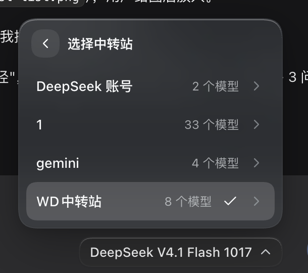

# dsh-model-tree-menu · 模型选择多级菜单

把 DeepSeek Harness 对话输入区的**模型选择器**从"一级平铺"改成**多级菜单**：先按「中转站（provider）」分组列出，点进某个中转站后，只显示该站下的模型，选中即切换。多个中转站的模型再多也能一眼找到想用的那个。

界面采用 **iOS 18 磨砂玻璃**质感：半透明背板、背景模糊、大圆角、柔和阴影；每个中转站内支持按模型名**模糊搜索**。

> A multi-level model picker for DeepSeek Harness. Group models by relay (provider) first, then drill into a provider's models — with an iOS 18 frosted-glass look and per-relay fuzzy search.

---

## 效果预览 · Screenshots

| 中转站列表（第一级） | 站内模型列表（第二级） |
| --- | --- |
|  |  |

---

## 功能 · Features

- **两级菜单**：`模型按钮 → 中转站列表 → 该站模型列表`，先选中转站再看模型。
- **按站分组**：每个中转站单独一层，不再把所有模型混在一起。
- **站内模糊搜索**：进入某站后可输入关键字，仅在该站模型内模糊匹配。
- **推理等级**：仍可从根菜单进入并切换（不改变原有能力）。
- **iOS 18 磨砂玻璃**：背景模糊 + 半透明 + 大圆角 + 柔和阴影，自动适配明暗主题。
- **完整键盘交互**：方向键移动、`Enter` 选择、`Esc` 返回上一级/关闭、搜索框内 `↑/↓` 循环高亮。
- **错误友好**：目录加载失败、会话占用等场景有提示与"重新加载"，不会整块空白。
- **复用宿主数据通道**：直接使用 Harness 现成的模型目录服务与 `selectModel`，不新建数据链路。

## 安装 · Install

本插件是一个 DSH **bundle**（前端 Client 插件 + 空 Host 半侧）。

### 方式一：本地目录安装（开发/自用）

1. 把本仓库放到一个本地目录，例如 `~/plugins/dsh-model-tree-menu`。
2. 在 DSH 中用插件管理器安装该目录（`install_bundle`），或把它加入 profile 的 `dsh.profile.bundles`。
3. **完全重启** DeepSeek Harness 桌面应用（这是桌面应用而非 `dsh web` 开发服务器，新的 Client 模块需要重启后加载）。

### 方式二：从 GitHub 安装

```sh
dsh plugin --profile <你的 profile> add github:<you>/dsh-model-tree-menu
```

安装后重启宿主。若宿主是 **DSH 桌面应用**，请通过应用内的 **设置 → 插件** 安装，桌面应用使用自己的 profile。

## 使用 · Usage

1. 打开任意对话，点输入区的模型按钮。
2. 菜单立即显示**中转站列表**（带各自的模型数量）。
3. 点某个中转站 → 进入该站**模型列表**，可搜索、点选。
4. 选中后自动切回，模型按钮更新为新模型。
5. 需要调整推理等级时，从根菜单进入"推理等级"。

## 工作原理 · How it works

- 注册到 Harness 的 `conversation.input.model` 单插槽（`priority` 高于内置选择器以接管它）。
- 通过公开服务 `ctx.modelDirectories`（`directoryFor(sessionId)` 的 `store / load() / select()`）读取模型目录并执行切换，不新建 IPC。
- 菜单以 `ReactDOM.createPortal` 挂到 `document.body`，因此磨砂玻璃能采样到页面/对话内容而非输入框卡片自身。
- 样式仅使用 `--dsw-alias-*` / `--dsw-*` 主题 token，自动适配浅色/深色。
- 所有资源在 `ctx.effect` 内注册并返回清理；组件外包一层错误边界，异常时降级为一行提示而非整块消失。

## 兼容性 · Compatibility

- 目标宿主：DeepSeek Harness 0.2.1+（Web UI / 桌面应用）。
- 依赖（均为宿主自带、无需自行安装）：
  - `@deepseek-ai/dsh-client-ui-conversation`
  - `@deepseek-ai/dsh-client-ui-model-selection`（提供 `modelDirectories` 服务）

## 目录结构 · Layout

```
.
├── package.json          # bundle 清单（dsh.bundle + dsh.client）
├── cordis.patch.yml      # 插入 Host 行
├── index.js              # Host 半侧（空）
├── client.js             # Client 半侧：多级菜单组件与注册
├── locale/
│   ├── zh.json           # 插件市场显示元数据（中文）
│   └── en.json           # 插件市场显示元数据（英文）
├── icon.svg              # 插件图标
└── docs/screenshots/     # 功能截图
```

## License

MIT
